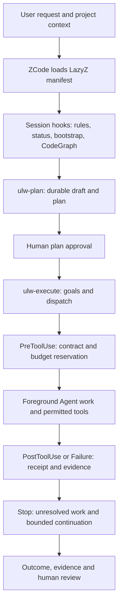

# LazyZ architecture

Snapshot: 2026-10-17, plugin 0.11.0. Implementation inventory, not live-host certification.

## Product boundary

LazyZ is a local ZCode plugin. It coordinates coding work through skill prompts,
agent profiles, Node hooks, MCP servers and project-local files. It is not a
hosted SaaS, web server, database service or independent model provider.
The development workspace also contains an Xcode product and recovery packages;
they are not part of this public distribution.

The marketplace source stays `./plugins/lazyz`. Moving it to `products/` would
change installation and build contracts without improving the current boundary.

```text
lazyz/                         Public source repository
├── marketplace.json           Stable plugin discovery contract
├── README.md / BIG-PICTURE.md  Product entry and current feature map
├── docs/
│   ├── architecture/          Current boundaries and service flow
│   ├── maintenance/           Local import and publication procedure
│   ├── reports/               Dated analysis and file-hash provenance
│   └── waterfall/             Preserved July 2026 historical documents
├── scripts/                   Local publication maintenance only
├── .github/                   CI, ownership and contribution templates
└── plugins/lazyz/              Installable plugin and contributor sources
    ├── .zcode-plugin/         Host manifest
    ├── .mcp.json / hooks/     Active server and lifecycle registrations
    ├── skills/ / commands/    Workflow instructions and five entry points
    ├── agents/                Thirteen inherited-model role profiles
    ├── components/            Hook services; source, tests and shipped dist
    ├── runtime/ / dist/cli/   Root CLI source and prebuilt entry point
    ├── shared/ / vendor/     Build inputs and local runtime dependencies
    ├── policies/             Machine-consumed policies
    ├── scripts/ / test/      Build, release and root safety checks
    └── docs/                  Plugin-specific contracts and limitations
```

## Runtime flow



Static alternative: request → project context → plan → human approval →
budgeted execution → task-bound receipt → bounded continuation → human review.
The model proposes tool use and interprets results. The host runs those tools;
an artifact hash does not prove the actor or command came from a trusted runner.

## State and ownership

| State | Owner / location | Contract |
| --- | --- | --- |
| Plan and execution notes | Project `.omo/plans`, Boulder, evidence ledger | Partly model-written, soft schema; not a transactional database |
| Durable goals | `components/ulw-loop`, `.omo/ulw-loop` | Versioned goals, plan/criterion binding |
| Dispatch attempts | Executor verifier | Stable task ID, fresh run ID, call/failure budget, receipts |
| Rules and LSP caches | Host plugin data | Separate `ZCODE_PLUGIN_DATA/rules/sessions` and `lsp/sessions` |
| CodeGraph | CodeGraph component and external managed process | Provisioning/lifecycle safeguards; host operation still needs observation |
| Publication provenance | `docs/reports/source-snapshot.json` | Actual copied hashes, source commit, dirty flag; not a signature |

Two state families still coexist. A single transaction/lock encompassing the
entire plan → dispatch → evidence lifecycle has not been demonstrated. Targeted
path guards and file locks must not be described as an operating-system sandbox.

## Code service boundaries

| Component | Responsibility |
| --- | --- |
| bootstrap | Install/payload readiness and startup guidance |
| codegraph | Graph provisioning and process lifecycle |
| rules | Static and tool-related rule injection |
| work-status | Resume/status snapshot and degraded-state handling |
| git-bash | Git/tool guidance and session markers |
| lsp | Code intelligence guidance and diagnostics |
| comment-checker | Post-edit comment checking |
| ultrawork | Prompt detection and bounded transcript lookup |
| lazycodex-executor-verify | Dispatch admission, budgets, receipts and unresolved tasks |
| start-work-continuation | Bounded Stop continuation |
| ulw-loop | Goal persistence, criterion/evidence gates and loop commands |
| telemetry | Explicit opt-in daily-active signal |

`components/teammode` contains scripts, not another package-bearing service.
`components/test-support` supplies tests. Vendored source remains because the
contributor build uses it; runtime-only releases use a separate export allowlist.

## External calls and limits

Four MCP servers are local (`codegraph`, `git_bash`, `lsp`, `ast_grep`); two are
remote (`grep_app`, `context7`). Local tools may still provision packages or use
external resources. Agent budgets cover governed dispatch, not every nested tool,
HTTP request, token or monetary cost. Five normal SessionStart hooks may run in
sequence; timeout budgets are not measured latency. No claim of overall speedup
or cost reduction is made by this structure change.
