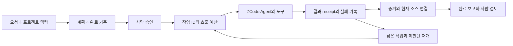

# LazyZ 상세 기능·변경·공개 구조 보고서

기준일: **2026-10-17 (Asia/Seoul)**. 대상: 개발 폴더의 실제 작업 파일과
`younghai/lazyz` 공개용 체크아웃. 구현 여부는 소스 기준이며, 실제 ZCode
운영 성공·사용자 생산성·최신 upstream 전체 반영을 뜻하지 않는다.
분석은 17일에 시작했고, 로컬 문서 정리 완료일은 18일이다. 기준 제품 버전은
동일한 0.11.0이며 작성일 변경을 새 기능 출시로 해석하지 않는다.

## 1. 결론

LazyZ는 초기의 스킬/훅 묶음에서 **계획 승인, 작업별 실행 예산, 결과 증거,
재개 안내를 제공하는 ZCode용 로컬 코딩 작업 도구**로 확장됐다.
웹 서비스나 데이터베이스 서버를 새로 만든 제품은 아니다.

개발 폴더는 0.11.0이지만 공개 저장소와 공개용 로컬 폴더는 조사 시작 시
0.10.2였다. 이번에는 이미 개발돼 있던 기능을 공개용 폴더에 반영하고,
현재 문서·과거 문서·개발 소스·설치 파일의 경계를 정리했다.
0.11.0 기능 전체를 10월 17일에 새로 개발했다는 의미가 아니다.

가장 큰 강점은 ZCode의 실제 이벤트와 에이전트 등록 방식에 맞춘 실행 관리다.
가장 큰 잔여 과제는 서로 다른 상태 저장 방식, `/start-work`의 이전 안내,
실제 호스트 검증과 비용/성능 측정 부재다. 특히 완료 증거의 해시는 증거 파일의
내용을 연결할 뿐, 독립된 신뢰 실행자가 실제 명령을 수행했음을 보증하지 않는다.

## 2. 비교 기준과 정확도

| 기준 | 근거 | 의미 |
| --- | --- | --- |
| 초기 0.1.x | 개발 Git `09ce304`, `65fd228`, `9edaae4`, 2026-07-05 | 최초 자기완결형 소스와 0.1.1 사전 빌드 배포 |
| 이전 공개본 | `younghai/lazyz` main `64b0d5ac509e0bca72c90d9f663ea00c8f84312f`, 2026-07-20 | 0.10.2, 이번 작업 전 로컬 공개용 폴더와 동일 |
| 현재 개발본 | 개발 HEAD `d1996f5051417ec693b9e42fbed0700f368e438e` + 작업 파일 | 미커밋·미추적 파일도 포함한 0.11.0 작업 트리 |

현재 개발 HEAD의 정확한 값은 `d1996f5051417ec693b9e42fbed0700f368e438e`이다.
HEAD 날짜는 7월 30일이므로 이 커밋만으로 10월의 작업 파일을 재현할 수 없다.
[파일별 SHA-256 snapshot](source-snapshot.json)이 실제 가져온 내용을 식별한다.

판정은 네 가지로 나눈다: **소스 확인**, **선언/문서 확인**, **과거 검사 기록**,
**현재 실제 실행 확인**. 한 종류를 다른 종류의 증거로 바꾸어 쓰지 않는다.
원격 조회 당시 GitHub Pages는 비활성 상태였다. 사용자 URL은 공개 저장소이며
별도 홈페이지 배포까지 포함하는 요청으로 해석하지 않았다.

## 3. 초기 → 공개본 → 현재 수량 비교

| 항목과 집계 단위 | 초기 0.1.x | 7월 20일 공개본 | 10월 17일 개발 snapshot |
| --- | ---: | ---: | ---: |
| 최상위 `skills/*/SKILL.md` | 23 | 25 | 29 |
| `agents/*.md` | 0 | 13 | 13 |
| `commands/*.md` | 0 | 4 | 5 |
| 루트에 등록된 훅 실행 항목 | 13 | 16 | 20 |
| 루트 훅 이벤트 종류 | 5 | 5 | 6 |
| MCP 서버 선언 | 5 | 5 | 6 |
| package.json을 가진 component | 12 | 별도 집계하지 않음 | 12 |

공개본 changelog의 “초기 25 skills / 10 agents / 16 hooks”와 “공개본 10 agents”는
Git 트리 집계와 다르다. 따라서 이 보고서는 설명문 숫자가 아니라 실제 파일과
manifest를 기준으로 했다. `teammode`는 scripts-only, `test-support`는 테스트 지원
디렉터리이므로 “component 디렉터리 14개”와 “패키지 12개”를 혼용하면 안 된다.

현재 훅: SessionStart 7, UserPromptSubmit 3, PreToolUse 2, PostToolUse 5,
PostToolUseFailure 1, Stop 2. SessionStart 7개 중 2개는 `compact|clear` 조건부다.
이벤트 수는 호스트가 지원하는 전체 이벤트 수가 아니라 LazyZ가 등록한 수다.

## 4. 현재 기능 전체 목록

### 4.1 사용자가 진입하는 다섯 명령

| 명령 | 제공 기능 | 경계 |
| --- | --- | --- |
| `/init-deep` | 프로젝트 구조·지침을 계층적 AGENTS 문서로 정리 | 자동으로 올바른 업무 지식을 보증하지 않음 |
| `/ulw-plan` | 요구사항과 완료 기준을 실행 가능한 계획으로 저장 | 계획 작성과 실행 승인은 별개 |
| `/ulw-execute` | 승인된 계획 실행, 목표 등록, 진행/증거 연결 | 현재 권장 실행 진입점 |
| `/start-work` | 기존 계획 실행/재개 호환 진입점 | 이전 Codex 안내와 승인 전제 충돌이 남음 |
| `/ulw-loop` | 여러 목표의 지속 상태·완료 기준·증거 관리 | 호스트 종료/압축 뒤 무조건 자동 복구하는 서비스 아님 |

### 4.2 29개 스킬

| 분야 | 스킬 |
| --- | --- |
| 프로젝트·계획·실행 | `init-deep`, `ulw-plan`, `ulw-execute`, `start-work`, `ulw-loop` |
| 일반 개발·개선 | `programming`, `debugging`, `refactor`, `remove-ai-slops` |
| 화면·검토 | `frontend`, `visual-qa`, `review-work` |
| 코드 지식·규칙 | `rules`, `comment-checker`, `lsp`, `lsp-setup`, `ast-grep` |
| 조사·도구 | `git-master`, `ulw-research`, `ultimate-browsing`, `coding-agent-sessions` |
| 고급 작업 | `ultrawork`, `teammode`, `data-scientist`, `benchmark-checklist`, `blast-radius` |
| upstream 기여 | `lcx-contribute-bug-fix`, `lcx-doctor`, `lcx-report-bug` |

초기 대비 추가된 6개는 `benchmark-checklist`, `blast-radius`, `data-scientist`,
`teammode`, `ultrawork`, `ulw-execute`다. 스킬 파일 존재는 해당 외부 도구가
설치되어 있거나 호스트가 모든 workflow를 지원한다는 의미가 아니다.
`teammode`도 ZCode에 Codex의 팀 스레드 API가 생겼다는 뜻이 아니다.

### 4.3 13개 에이전트 역할

- 조사: `explorer`, `librarian`.
- 계획: `metis`, `plan`, `momus`.
- 구현: `lazycodex-executor`, `lazycodex-worker-low`, `lazycodex-worker-medium`, `lazycodex-worker-high`.
- 검토/증거: `lazycodex-code-reviewer`, `lazycodex-clone-fidelity-reviewer`, `lazycodex-qa-executor`, `lazycodex-gate-reviewer`.

현재 역할들은 모델을 고정하지 않고 `inherit`를 사용한다. 활성 플러그인의
`agents/`에서 발견하도록 등록되며, 사용자 설정에 역할을 강제로 설치하는
이전 방식과 구분된다. 실제 사용할 수 있는 역할과 도구는 호스트가 결정한다.

### 4.4 MCP와 운영 CLI

| 표면 | 현재 내용 |
| --- | --- |
| 로컬 MCP 4개 | `codegraph`, `git_bash`, `lsp`, `ast_grep` |
| 원격 MCP 2개 | `grep_app`, `context7` |
| 상태 검사 | `lazyz doctor`: 파일/manifest 정적 검사, 실제 연결 검사가 아님 |
| 호환 계약 | `lazyz capabilities`: 검토된 소스 계약 표시, 설치 호스트 탐지 아님 |
| 초기 설정 | 명시적 동의를 전제로 한 `setup` |
| 목표 관리 | `lazyz ulw-loop` 하위 명령 |
| 프로세스 진단 | 루트 CodeGraph sweep은 읽기/진단 범위 |
| 배포 | 런타임 허용 목록, 파일 해시 manifest, source-free payload 생성 |

## 5. 실제 서비스 흐름과 상태 구조

정적 흐름: **요청 → 프로젝트 지침 → 계획 → 사람 승인 → 작업별 예산 예약 →
에이전트 실행 → 결과/실패 기록 → 증거 확인 → 재개 또는 완료 보고**.

AI는 맥락을 받아 작업과 도구 호출을 제안하고 결과를 해석한다. 실제 파일 조작은
호스트 도구가 수행한다. 내부 추론을 관찰했다는 의미가 아니며, 사람은 승인 범위와
결과의 적합성을 확인해야 한다.

계획 Markdown, `.omo/boulder.json`, evidence ledger는 일부 모델이 작성하는
느슨한 상태다. `ulw-loop/goals.json`은 버전이 있는 상태다. 서로 다른 저장 모델이
공존하며 하나의 데이터베이스 트랜잭션으로 통합됐다고 볼 근거는 없다.
rules/LSP 캐시는 `ZCODE_PLUGIN_DATA`의 서로 다른 하위 경로를 사용한다.

## 6. 주요 업데이트 12가지

| 변경 | 초기와의 차이 | 업무 의미와 한계 |
| --- | --- | --- |
| 자기완결형 배포 | vendored 소스에서 0.1.1의 사전 빌드까지 확장 | 설치 시 빌드 부담 감소는 초기 0.1.1 성과; 0.11 신규로 포장하지 않음 |
| workflow 확장 | 스킬 23→29, 명령 0→5 | 계획/실행 진입점 명확화, 메뉴 복잡도도 증가 |
| 역할 등록 | 초기 프로필 0→13, 현재 모델 상속 | 사용자 선택 모델 유지, 역할 분업 가능 |
| 직접 프로세스 훅 | shell wrapper 중심에서 Node/args/timeoutMs로 | 중간 launcher 감소; 실제 시간 절감 미측정 |
| Agent 수명주기 | 호스트에 없는 SubagentStop 전제에서 Pre/Post/Failure/Stop 연결로 | 실행 전 예약과 실행 후 증거 처리를 연결 |
| 구조화된 증거 | 파일 존재 중심에서 task/run/role/criteria/source/hash 연결로 | 다른 작업의 오래된 결과를 완료 근거로 쓰는 위험 감소 의도 |
| 호출/실패 제한 | 작업별 기본 최대 5회 호출·동일 실패 3회 | 과도한 재시도 제어; 모든 내부 API/토큰 비용의 통합 예산은 아님 |
| 비동기 의미 정리 | 구조화된 백그라운드 dispatch를 예약 전 차단 | 시작 응답을 완료로 오인하지 않음; 장기 백그라운드 관리 기능은 제한 |
| 실행 승인 분리 | `/ulw-execute`가 승인된 기존 계획 실행을 요구 | 기존 `/start-work` 문구 충돌은 후속 정리 필요 |
| MCP 확대 | 5→6, AST-grep 로컬 서버 추가 | 코드 탐색 수단 확장; 실제 서버 시작은 별도 확인 |
| ZCode 상태 적응 | plugin data 경로, optional model/turn, 캐시 분리 | Codex 전용 전제 축소; 모든 상속 문서가 정리된 것은 아님 |
| 운영/프라이버시 | CodeGraph 1.5.0, opt-in DAU, CLI/배포 무결성 도구 | 운영 표면 강화; 제품 이벤트 분석/성능 개선 수치는 미제공 |

CodeGraph의 1.5.0 표기는 현재 provisioning 코드 기준이다. 사용자의 설치된
외부 CodeGraph 실행 파일을 조사해 동일 버전이라고 확인한 것은 아니다.
ZCode 계약은 **10월 7일 검토한 3.14.3**이며, 이를 10월 17일 최신 버전이라고
표현하지 않는다. LazyCodex/OmO upstream의 10월 17일 전체 최신성을 별도로
재검증한 작업도 아니다.

## 7. 시기별 해석

| 시기 | 확인된 변화 | 근거 종류 |
| --- | --- | --- |
| 7월 5일 | vendored 자기완결 구조, 초기 23개 스킬, 0.1.1 사전 빌드 | 최초 Git 커밋 |
| 7월 12~20일 | 명령 진입점·역할 분업·teammode·continuation 제한·운영 문서 | Git 이력과 0.10.2 공개 트리 |
| 7월 말 이후 | 개발 루트에서 Xcode 작업과 LazyZ 작업이 함께 존재 | 개발 HEAD/폴더 구조, 제품 경계는 별도 |
| 8~9월 및 10월 7일 작업 파일 | 경로/잠금·작업 증거·예산·배포 도구·ZCode-native 적응 축적 | 현재 소스와 날짜가 있는 내부 보고서; 미커밋이 많아 변경별 정확한 최초 도입일 일부 불명 |
| 10월 17일 이번 작업 | 현황 재집계, 공개용 0.11.0 소스 반영, 문서/CI/동기화 구조 정리 | 이번 로컬 작업과 snapshot; GitHub 게시 아님 |

파일 수정 시각이나 오래된 보고서의 완료 문구만으로 정확한 출시일을 만들지 않았다.
과거 10월 7일 검사 기록은 이번 날짜의 재검사 결과로 승격하지 않는다.

## 8. 폴더와 소스 구조 평가

개발 루트는 플러그인, Xcode, 복구용 upstream 패키지, 개인 문서, 실행 기록이
섞인 작업 공간이다. 이를 공개 저장소로 통째로 복사하면 제품 범위와 공개 범위가
혼동된다. 공개본은 설치 경로를 보존한 **플러그인 전용 소스 저장소**로 정리했다.

현재 구조의 강점은 `components/*`별 책임 분리와 테스트/빌드 단위, 자기완결형
vendor 입력, 설치에 필요한 prebuilt 보존이다. 약점은 빌드 입력과 런타임 산출물의
중복, vendored upstream의 문서 잔재, 여러 상태 저장 방식, 루트 문서와 실제 코드의
시점 불일치다. 미리 빌드된 파일을 없애거나 vendor를 일괄 삭제하는 방식은 설치와
재빌드를 깨뜨릴 수 있어 이번 구조 정리에서 하지 않았다.

상세 디렉터리 트리·12개 컴포넌트 책임·상태 소유권은
[현재 아키텍처](../architecture/overview.md)에 정리했다.
`products/lazyz-zcode`로의 물리 이동은 이번에 하지 않았다. 공개본에는 Xcode가
없으므로 현재 `plugins/lazyz` 경계를 유지하는 것이 설치 계약에 맞다.

## 9. 남은 위험과 제안 우선순위

| 우선순위 | 발견/한계 | 영향 | 권장 후속 작업 |
| --- | --- | --- | --- |
| 높음 | `/start-work`에 Codex Stop/SubagentStop, 수동 Boulder, 계획 없을 때 생성/실행 안내 잔존 | 승인·호스트 이벤트·상태 소유권을 서로 다르게 해석할 수 있음 | `/ulw-execute` 계약으로 호환 진입점 통일; 허용 시 해당 경로 검사 |
| 높음 | 실제 ZCode 설치/Agent/MCP 연결 검증 없음 | 소스/manifest 정상이어도 운영 실패 가능 | 게시 전 승인된 실제 프로젝트의 작은 계획→실행→실패→재개 시나리오 |
| 높음 | 소스 HEAD와 작업 파일 불일치 | 커밋 하나로 공개본 재현 불가 | 이번 snapshot과 함께 의도한 변경을 별도 승인 후 커밋 |
| 중간 | Boulder/ledger와 versioned goals가 분리 | 중단·동시 변경에서 일관된 복구 보장 어려움 | 단일 상태 작성 경계와 전이 규칙부터 설계, 전면 재작성은 보류 |
| 중간 | receipt는 파일 결합이며 신뢰 실행 증명은 아님 | 조작된 증거의 신뢰 한계 | 로컬 신뢰 실행기/서명 필요성부터 위협 모델에 따라 결정 |
| 중간 | 예산이 Agent dispatch 단위 | 내부 도구/API 호출 폭증을 완전히 제한하지 못함 | 작업별 tool/API 호출 수·시간·읽은 바이트 집계 연결 |
| 중간 | SessionStart 정상 경로 5개 훅, 병렬 보장 없음 | 시작 지연 누적 가능 | 실제 지연 분포를 측정한 후 불필요한 읽기·프로세스 시작 줄이기 |
| 중간 | Stop 최대 3회·압축 후 재개 비보장 | 장기 무인 완료 보장 불가 | 명시적 재개 안내와 중단 상태 표시 유지 |
| 낮음 | CI의 Bun 버전이 `latest` | 빌드 재현성 흔들림 가능 | 실제 검증한 버전을 정한 뒤 pin; 이번에는 임의 버전 업그레이드하지 않음 |
| 낮음 | 외부 도구 필요 스킬과 현재 UI 표시 제약 | 모든 스킬이 바로 작동한다고 오해 가능 | 처음 사용할 명령을 줄여 안내하고 요구 환경을 개별 표시 |

이번 보고서는 전 파일의 취약점 스캐너 감사나 성능 프로파일링이 아니다.
“치명적 오류가 전혀 없다”, “호출 비용이 줄었다”, “보안이 완성됐다”는 결론을
내릴 근거가 없다. 변경된 공개 SECURITY 문서는 기존의 부정확한 네트워크 부재
보장 대신 실제 원격 MCP·provisioning·증거 파일 위험을 명시한다.

## 10. 이번 공개용 폴더 반영

- 설치 경로 `plugins/lazyz`와 두 저장소의 Git 이력을 유지했다.
- 최초 동기화에서 허용된 파일 2,592개 중 610개를 반영했다: 새 파일 319개,
  기존 파일 갱신 291개. 대상에만 있는 허용 범위 파일은 0개였다.
- 이어서 설치 저장소 URL과 권장 실행 흐름을 plugin README에 맞추었다.
  최종 파일별 내용은 snapshot 기준이며 위 수치는 최초 동기화 작업량이다.
- Xcode, 개인 문서, root 실행 보고서, `.omo`/세션/캐시, `node_modules`, 환경
  파일과 임시 CodeGraph 작업 공간은 가져오지 않았다. 파일 삭제는 하지 않았다.
- root README, 현재 아키텍처, 문서 색인, 현황 지도, 기여/보안 문서, 게시 절차를
  분리했다. July waterfall 문서는 역사 자료로 남겼다.
- 기존 CI 하나를 갱신했다. `npm ci`, component typecheck/test, ZCode 잔재 검사,
  prebuilt/CLI drift, runtime-only release 검사가 정의되어 있다. 실행 결과는 아님.
- 기존 npm lock을 보존하고 Git 예외를 추가했다. 패키지 매니저 전환이나
  dependency upgrade/install은 수행하지 않았다.
- 저장소 자동 게시·commit·push·GitHub Pages 배포는 수행하지 않았다.

## 11. 출처와 검증 범위

주요 소스: [plugin manifest](../../plugins/lazyz/.zcode-plugin/plugin.json),
[hooks](../../plugins/lazyz/hooks/hooks.json), [MCP](../../plugins/lazyz/.mcp.json),
[ZCode contract](../../plugins/lazyz/runtime/zcode-contract.mjs),
[executor verifier](../../plugins/lazyz/components/lazycodex-executor-verify/src/codex-hook.ts),
[task state](../../plugins/lazyz/components/lazycodex-executor-verify/src/task-state.ts),
[receipt](../../plugins/lazyz/components/lazycodex-executor-verify/src/structured-receipt.ts),
[quality binding](../../plugins/lazyz/components/ulw-loop/src/quality-gate-binding.ts),
[start-work](../../plugins/lazyz/skills/start-work/SKILL.md),
[ulw-execute](../../plugins/lazyz/skills/ulw-execute/SKILL.md),
[limitations](../../plugins/lazyz/docs/known-limitations.md).

실제 상세 소스 탐색은 [plugin 루트](../../plugins/lazyz/)를 기준으로 한다.
외부 출처: [공개 저장소](https://github.com/younghai/lazyz),
[검토된 ZCode 문서](https://zcode.z.ai/en/docs/hooks).

이번 작업의 실행 증거와 정확한 검사 범위는 개발 폴더의
`reports/ai-review/2026-10-17-feature-evolution-publication.html`에 기록한다.
소스 분석/집계와 동기화 도구의 제한된 검사는 현재 증거다. GitHub CI, 실제 ZCode
호스트, 외부 MCP 연결, Windows, 모델 비용·업무 시간 효과는 별도 미검증이다.

이번 공개용 경로의 `doctor --json`은 `ok: true`였고 20개 process 훅,
manifest 버전, CLI 소스/출력 provenance, CodeGraph 1.5.0을 정적으로 확인했다.
단, 기존 LSP daemon 상태에 0.1.0이 남아 있고 사용자 CLI 링크는 이 공개용
폴더 바깥을 가리킨다는 경고 2개가 있었다. 사용자 환경은 변경하지 않았다.
이 결과에는 `hostVerified: false`가 명시되어 있다.

새 동기화 도구는 문법·도움말·잘못된 입력·실제 복사를 확인했고, 기존 plugin
CLI도 도움말과 잘못된 명령 거절을 확인했다. CI YAML은 파싱됐지만 GitHub에서
실행하지 않았다. 공개용 폴더에는 빌드 dependency 설치가 없어 전체 재빌드는
하지 않았다. 전체 테스트·typecheck·실제 호스트/외부 연결·문서 렌더 검증은
미실행이다. 자동 사후 검증 생략에는 사용자 전역 정책을 적용했으며, 위 최소
CLI/설정 검사는 상위 개발 지침이 요구한 범위다.
