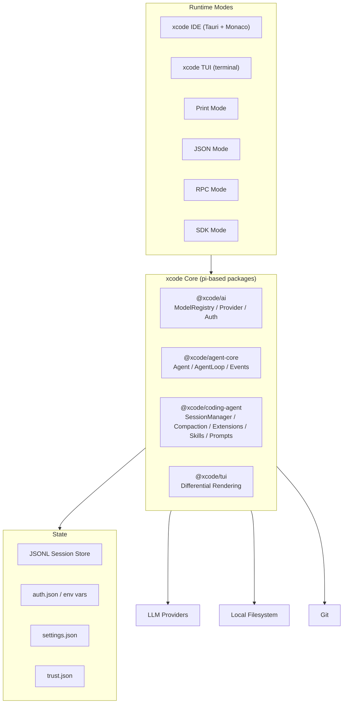
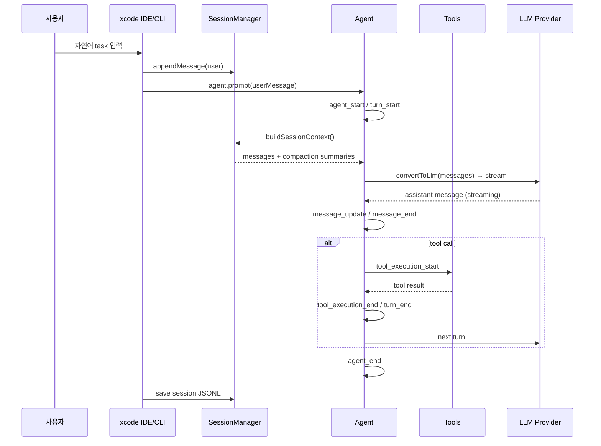

# xcode 서비스 기획서

- 문서 버전: v0.3
- 작성일: 2026-07-25
- 상태: Phase 0~1 기획 (개발 시작 전)
- 기반 모델: **[earendil-works/pi](https://github.com/earendil-works/pi)** — AI agent toolkit: unified LLM API, agent loop, TUI, coding agent CLI

---

## 1. 비전과 문제 정의

**비전**: "개발자가 AI 에이전트에게 실제로 끝까지 일하게 만드는 agent-native coding IDE"

| 구분 | 내용 |
|---|---|
| 문제 | 기존 AI 코딩 도구는 짧은 대화엔 강하지만, 대화가 길어지면 context를 잃고 멈추거나, 반복 작업에서 멍청해지거나, 에이전트가 중간에 포기한다. 개발자는 결과를 검증하고 이어서 돌려야 하는 부담이 크다. |
| 해결 | pi-coding-agent의 **Agent Loop + JSONL Session Tree + Compaction**을 기반으로, **Extension/Skill/Prompt Template**으로 확장 가능한 하네스를 IDE에 탑재한다. |
| 기반 모델 | **pi-coding-agent** — `@earendil-works/pi-ai`, `@earendil-works/pi-agent-core`, `@earendil-works/pi-coding-agent`, `@earendil-works/pi-tui` |

---

## 2. pi 기반 설계 철학

xcode는 pi의 철학을 따른다.

- **Minimal Core**: sub-agents, plan mode, MCP, permission popups, background bash, built-in to-dos는 처음부터 내장하지 않는다.
- **Aggressive Extensibility**: extension, skill, prompt template, pi package로 사용자가 원하는 workflow를 직접 만들거나 설치한다.
- **JSONL Session Tree**: append-only 세션 로그에 `id`/`parentId`로 branching을 지원하여 compaction과 함께 강력한 메모리 모델을 만든다.
- **Agent Loop Engineering**: `AgentMessage[] → transformContext() → convertToLlm() → Message[] → LLM` 흐름을 기본으로 한다.
- **Project Trust**: project-local 설정/extension/skill은 사용자 승인 후 로드한다.
- **Supply-chain Hardening**: `--ignore-scripts`, pinned dependencies, offline mode, telemetry opt-out를 기본으로 한다.

---

## 3. 페르소나

1. **개발자 (Primary)** — 일상적인 코딩, 리팩토링, 버그 수정, 기능 구현. AI에게 task를 던지고 끝까지 완료되기를 원함.
2. **팀 리드/시니어** — 코드 리뷰, 표준 준수, 복잡한 설계 결정. 팀 전체의 coding agent workflow를 관리.
3. **AI 도구 빌더** — 자신만의 extension/skill/agent를 만들어 xcode 생태계에 기여.
4. **운영자/SRE** — agent 실행 로그, 비용, 장애 대응, 모델 사용량 모니터링.

---

## 4. 핵심 기능 및 구현 현황

| 도메인 | 기능 | 상태 | pi 대응 | 비고 |
|---|---|---|---|---|
| Runtime Modes | interactive / print / json / rpc / sdk | 🔲 Phase 1 | `pi-coding-agent` 모드 | IDE + CLI + 임베딩 |
| IDE Core | 코드 편집, 탐색, 터미널 통합 | 🔲 Phase 1 | `pi-tui` + Tauri wrapper | Monaco 기본 skeleton |
| TUI | terminal UI 대화형 모드 | 🔲 Phase 1.5 | `pi-tui` | differential rendering |
| Agent Loop | prompt → turn → tool call → result → next turn | 🔲 Phase 1 | `pi-agent-core` `Agent` class | streaming event 기반 |
| JSONL Session Tree | append-only + `id`/`parentId` branching | 🔲 Phase 1 | `pi-coding-agent` `SessionManager` | `/tree`, `/fork`, `/clone` |
| Compaction | auto/manual compaction + branch summarization | 🔲 Phase 1 | `packages/coding-agent/src/core/compaction` | structured summary |
| Message Queue | steering / follow-up | 🔲 Phase 1.5 | `pi-agent-core` queues | agent 실행 중 개입 |
| Tool System | read, write, edit, bash, grep, find, ls | 🔲 Phase 1 | built-in tools | parallel/sequential execution |
| Extension Runtime | TypeScript extension via jiti | 🔲 Phase 1.5 | `pi-coding-agent` extensions | custom tool/command/UI/event |
| Skill System | Agent Skills standard | 🔲 Phase 1/1.5 | `pi-coding-agent` skills | `SKILL.md` progressive disclosure |
| Prompt Templates | frontmatter + positional args | 🔲 Phase 1.5 | `pi-coding-agent` prompts | `/templatename` |
| Pi Packages | npm/git/local package distribution | 🔲 Phase 2 | `pi-coding-agent` packages | extension/skill/prompt/theme bundle |
| Multi-Provider LLM | OpenAI, Anthropic, Google, local, etc. | 🔲 Phase 1 | `pi-ai` `createModels()` | OAuth/API key/auth.json |
| Model Registry | provider catalog, thinking level, cache | 🔲 Phase 1 | `pi-ai` model registry | Ctrl+P cycling |
| Project Trust | `.xcode/` 리소스 승인 | 🔲 Phase 1 | `pi-coding-agent` project trust | 보안 기본값 |
| Context Files | `AGENTS.md`/`CLAUDE.md` auto-load | 🔲 Phase 1 | `pi-coding-agent` context files | walking up from cwd |
| Verified Completion | test evidence 기반 검증 | 🔲 Phase 1/1.5 | extension 또는 built-in | basic verify → full gate |
| Admin/Ops | 실행 로그, 비용 추적 | 🔲 Phase 2 | extension 또는 admin page | Filament/Tauri admin |
| Plugin Marketplace | 외부 package 배포 | 🔲 Phase 3 | pi package gallery | xcode ecosystem 확장 |

### Phase 현황

- **Phase 0 (현재)**: 기획/설계 문서 작성, pi-coding-agent 소스/알고리즘/아키텍처 분석, Phase 1 MVP 범위 확정
- **Phase 1 (목표, 3~4개월)**: IDE skeleton + Agent Loop + JSONL Session Tree + Compaction + built-in tools + multi-provider LLM + Project Trust
- **Phase 1.5 (목표, 4~6개월)**: Extension runtime + Skill system + Prompt templates + Message queue + TUI
- **Phase 2 (목표, 6~9개월)**: Pi packages + Code Intelligence + Admin/Ops + Workflow extension
- **Phase 3 (목표, 9~12개월)**: Marketplace + 협업 기능 + Enterprise

---

## 5. 기술 스택

```text
Core packages (pi 기반):
  @xcode/ai              ← @earendil-works/pi-ai (unified multi-provider LLM API)
  @xcode/agent-core      ← @earendil-works/pi-agent-core (agent loop, tool execution, event streaming)
  @xcode/coding-agent     ← @earendil-works/pi-coding-agent (CLI, session manager, compaction, extensions)
  @xcode/tui             ← @earendil-works/pi-tui (terminal UI differential rendering)

Desktop IDE : Tauri (Rust + Webview) 또는 Electron
Frontend    : React/Vue + Tailwind CSS + Monaco Editor
Backend     : Rust (core bridge) + Node.js/Bun (pi packages runtime)
AI          : pi-ai adapter (OpenAI, Anthropic, Google, local, custom)
Storage     : JSONL session files, SQLite (settings/cache), OS credential store
Infra       : Docker Compose, GitHub Actions
Test        : Rust/TS 단위 테스트, Agent simulation, Playwright E2E
```

---

## 6. 아키텍처 개요



---

## 7. 서비스 흐름



---

## 8. 수익 모델 (초안)

| 플랜 | 가격(월) | 한도 |
|---|---|---|
| Free | ₩0 | 로컬 모델만, 기본 agent, 프로젝트 3개 |
| Growth | ₩29,000 | 클라우드 모델 연동, extension/skill, 커스텀 도메인 |
| Pro | ₩99,000 | 무제한 agent, team 공유, priority support |

> 실제 과금 적용은 Phase 3 이후 검토.

---

## 9. 성공 지표 (KPI)

| 영역 | 지표 | 목표 |
|---|---|---|
| 제품 | task 완료율 (agent가 끝까지 완료) | ≥ 80% |
| 제품 | 평균 context compaction 횟수 대비 작업 완료율 | ≥ 90% |
| 제품 | 사용자 개입 횟수 / task | ≤ 2회 |
| 사업 | 활성 사용자 수 | 월 성장 10% |
| 사업 | Free→Growth 전환율 | ≥ 5% |
| 기술 | agent loop crash rate | < 1% |
| 기술 | compaction 정보 손실률 | < 0.1% |
| 기술 | IDE 응답 지연 | < 100ms |

---

## 10. 리스크

| 리스크 | 완화 |
|---|---|
| LLM 비용/장애 | pi-ai multi-provider fallback, local model 지원 |
| Context 손실 | pi compaction algorithm, structured summary, retainedTail checkpoint |
| Agent 무한 루프 | turn/cycle cap, steering/follow-up queue, human escalation extension |
| Extension full system access | Project Trust, code signing, optional container/sandbox |
| Package supply-chain 공격 | `--ignore-scripts`, pinned refs, shrinkwrap, audit |
| 개인정보 | secret redaction, PII 마스킹, auth.json 0600 permissions |

---

*문서 작성: 2026-07-25 · pi-coding-agent 소스/알고리즘/아키텍처 기반*
