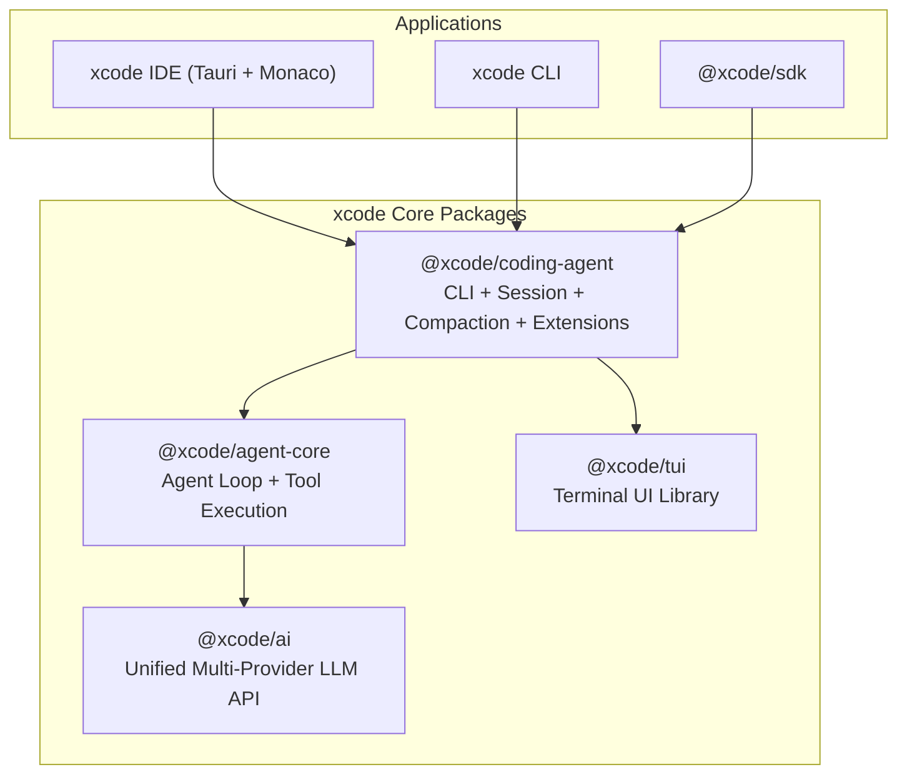
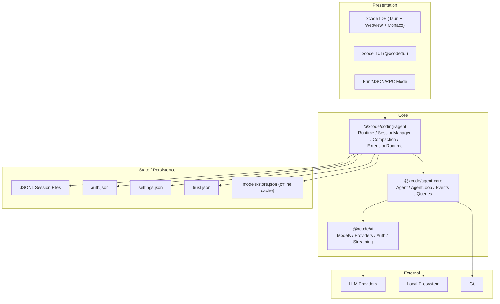

# xcode 시스템 아키텍처 설계서 (SAD)

- 문서 버전: v0.2
- 작성일: 2026-07-25
- 작성 기준: pi-coding-agent 소스 구조 (`packages/ai`, `packages/agent`, `packages/coding-agent`, `packages/tui`)

---

## 1. 패키지 구조

xcode는 pi와 동일하게 4개의 core package로 구성된다.

| Package | pi 대응 | 역할 |
|---|---|---|
| `@xcode/ai` | `@earendil-works/pi-ai` | Unified multi-provider LLM API. Model registry, provider abstraction, auth resolution, streaming. |
| `@xcode/agent-core` | `@earendil-works/pi-agent-core` | Stateful agent with tool execution and event streaming. Agent loop, tool registry, steering/follow-up queues. |
| `@xcode/coding-agent` | `@earendil-works/pi-coding-agent` | Interactive coding agent CLI. Session manager (JSONL tree), compaction, extensions, skills, prompts, packages, project trust. |
| `@xcode/tui` | `@earendil-works/pi-tui` | Terminal UI library with differential rendering. |

---

## 2. 계층 구조

---

## 3. 컴포넌트 구성

### 3.1 @xcode/ai

| 컴포넌트 | 역할 |
|---|---|
| `ModelRegistry` | provider/model 등록, 조회, thinking level 관리 |
| `Provider` | OpenAI, Anthropic, Google, local 등 개별 provider 구현 |
| `AuthResolver` | auth.json, env var, OAuth, CLI flag 순서로 credential 해석 |
| `StreamingClient` | SSE/websocket 기반 LLM streaming |
| `models-store.json` | offline model catalog cache |

### 3.2 @xcode/agent-core

| 컴포넌트 | 역할 |
|---|---|
| `Agent` | high-level stateful agent 클래스 |
| `agentLoop` / `agentLoopContinue` | low-level loop API |
| `ToolRegistry` | built-in + extension tool 등록/조회 |
| `AgentTool` | tool definition (name, parameters, execute, executionMode) |
| `EventBus` | agent_start, turn_start, message_update, tool_execution_end 등 이벤트 |
| `SteeringQueue` | 실행 중 사용자 개입 메시지 큐 |
| `FollowUpQueue` | 작업 완료 후 추가 메시지 큐 |
| `convertToLlm` | AgentMessage[] → LLM Message[] 변환 |

### 3.3 @xcode/coding-agent

| 컴포넌트 | 역할 |
|---|---|
| `SessionManager` | JSONL session tree CRUD, branching, context building |
| `CompactionEngine` | auto/manual compaction, branch summarization |
| `ExtensionRuntime` | jiti 기반 TypeScript extension 로드/실행 |
| `SkillRegistry` | Agent Skills standard skill discovery/load |
| `PromptTemplateRegistry` | frontmatter 기반 template discovery/expansion |
| `PackageManager` | npm/git/local package install/update/remove |
| `ProjectTrust` | `.xcode/` 리소스 승인 관리 |
| `ContextFileLoader` | `AGENTS.md`/`CLAUDE.md` auto-load |
| `BuiltInTools` | read, write, edit, bash, grep, find, ls |

### 3.4 @xcode/tui

| 컴포넌트 | 역할 |
|---|---|
| `TerminalRenderer` | differential rendering |
| `Editor` | multi-line input, external editor integration |
| `MessageView` | message/tool result 렌더링 |
| `Footer` | session info, token/cost usage, model status |

---

## 4. 외부 연동

| 시스템 | 용도 | 구현 위치 |
|---|---|---|
| OpenAI / Anthropic / Google | LLM | `@xcode/ai` providers |
| OAuth providers | subscription auth | `@xcode/ai` auth.json |
| llama.cpp / Ollama | local model | `@xcode/ai` custom provider |
| Git / GitHub | 버전 관리 | built-in `bash` tool + extension |
| Local Filesystem | 파일 I/O | built-in `read`/`write`/`edit` tools |
| npm registry / git | package distribution | `@xcode/coding-agent` PackageManager |

---

## 5. 디자인 패턴

| 패턴 | 적용 사례 |
|---|---|
| Package Monorepo | `@xcode/ai`, `@xcode/agent-core`, `@xcode/coding-agent`, `@xcode/tui` |
| Event-driven Architecture | `Agent.subscribe()`, extension events |
| Append-only Log | JSONL session tree |
| State Machine | Agent loop (turn-based) |
| Strategy | Provider abstraction, tool execution mode (parallel/sequential) |
| Middleware Chain | extension event handlers, beforeToolCall/afterToolCall |
| Progressive Disclosure | Skill descriptions in system prompt, full SKILL.md on-demand |
| Circuit Breaker | LLM provider fallback |

---

*문서 작성: 2026-07-25 · pi-coding-agent 소스 구조 기반*
