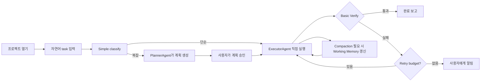

# xcode Phase 1 MVP 범위 확정서

- 문서 버전: v1.0-pi
- 작성일: 2026-07-25
- 상태: 확정 (개발 착수 기준)
- 기반 모델: **pi-coding-agent** — 4-package monorepo, JSONL session tree, event-driven agent loop, aggressive extensibility

---

## 1. 문서 리뷰 요약

기존 xcode 문서군(`서비스기획서.md`, `시스템아키텍처설계서-SAD.md`, `상세설계서.md`, `요구사항명세서-SRS.md`, `구현가이드.md`, `PI_BASED_MODEL_INTEGRATION.md`)과 **pi-coding-agent** 실제 구조를 교차 리뷰한 결과, 다음 정리가 필요했다.

| 항목 | 리뷰 코멘트 | 조치 |
|---|---|---|
| Phase 1 기간 | 0~3개월은 너무 빡빡함 | 3~4개월로 조정 |
| Package 구조 | pi는 `@pi/ai`, `@pi/agent`, `@pi/coding-agent`, `@pi/tui` 4개 패키지 | xcode도 `@xcode/ai`, `@xcode/agent-core`, `@xcode/coding-agent`, `@xcode/tui`로 동일하게 구성 |
| Multi-Agent Orchestration | MVP에 full orchestration은 범위 과다 | 단순 `classify` 분기 + Planner → Executor → Basic verify 흐름만 Phase 1에 포함 |
| Graph Engineering | DAG builder는 Phase 2 | Phase 1은 `classify` 단순 분기만 |
| CompactionEngine | 핵심 차별점이지만 P1로 분류됨 | P0로 격상 |
| JSONL Session Tree | append-only tree + branching/fork/clone | P0로 격상 |
| IDE skeleton | P2였으나 데모/검증에 필수 | P1로 격상 |
| Extension Runtime | jiti 기반 extension load, lifecycle events | Phase 1.5 (core는 P0 완료 후) |
| Skill System | custom skill 등록은 Phase 1.5 | built-in tool/skill만 Phase 1 |
| Prompt System | prompt directory + npm prompt packages | Phase 1.5 |
| Reviewer/QA Agent | P2지만 검증 파이프라인에 필요 | Phase 1.5로 이동, MVP는 basic verify(test)로 대체 |
| Working Memory | 현재 task의 goal/decisions/files/failures/next | P1 |
| Project Memory (`AGENTS.md`) | codebase-wide memory는 바로 필요하지 않음 | Phase 1.5 |
| Verified Completion | full gate review는 아직 어려움 | test evidence 기반 basic verified completion |
| Runtime Modes | pi는 interactive/print/json/rpc/sdk | xcode도 5가지 모드 지원, MVP는 interactive/print/json |
| Project Trust | pi는 project-local 리소스 승인 | xcode도 도입 |
| Supply-chain | pi는 `--ignore-scripts`, pinned deps | xcode도 동일 수준 강화 |

---

## 2. Phase 1 MVP 비전

> 개발자가 자연어로 코딩 task를 입력하면, xcode가 **계획 → 실행 → 검증**까지 끝내는 데모 가능한 agent-native coding IDE를 만든다.
>
> pi-coding-agent의 철학을 따른다: **minimal core + aggressive extensibility**. 복잡한 sub-agents, plan mode, MCP, permission popups, background bash, built-in to-dos는 내장하지 않고, extension/skill/prompt/package로 확장한다.

핵심 시나리오:
- "로그인 redirect 버그를 고쳐줘"
- "이 함수를 리팩토링해줘"
- "간단한 API 엔드포인트를 추가해줘"

---

## 3. Phase 1 MVP 범위

### 3.1 P0 — 반드시 Phase 1 내에 완료

| ID | 패키지 | 컴포넌트 | 설명 | 성공 기준 |
|---|---|---|---|---|
| P0-AI-001 | **@xcode/ai** | Provider abstraction | OpenAI Responses-style API + 로컬 모델(Ollama) fallback | chat/completions + streaming events 정상 동작 |
| P0-AI-002 | **@xcode/ai** | Event schema | `user`, `assistant`, `tool`, `system`, `summary` event payload 표준화 | 모든 이벤트가 schema에 맞게 직렬화/역직렬화 |
| P0-AGENT-001 | **@xcode/agent-core** | Agent loop | prompt → LLM → tool parse → tool exec → result append → repeat | 10회 이내 loop로 task 완료 |
| P0-AGENT-002 | **@xcode/agent-core** | JSONL Session Tree | append-only `.xcode/session.jsonl`, branching/fork/clone | fork/clone/branch 동작, tree integrity 유지 |
| P0-AGENT-003 | **@xcode/agent-core** | CompactionEngine | dedup → reduce old → semantic summary → hard cap | context 한도 초과 시에도 작업 재개 가능 |
| P0-AGENT-004 | **@xcode/agent-core** | Tool registry | built-in tool 등록/조회/실행 인터페이스 | read/edit/write/bash/test 등록 및 실행 |
| P0-AGENT-005 | **@xcode/agent-core** | Project Trust | `.xcode/` 내 리소스(agent config, extension, package, skill) 로드 전 승인 | 미승인 시 로드 차단 100% |
| P0-CODE-001 | **@xcode/coding-agent** | Built-in tools | `read`, `edit`, `write`, `bash`, `test` 구현 | 샘플 task에 정상 사용 |
| P0-CODE-002 | **@xcode/coding-agent** | Planner | codebase 탐색 후 task plan 생성, tool calls 사용 | plan이 후속 tool call로 실행 가능 |
| P0-CODE-003 | **@xcode/coding-agent** | Simple classify | task를 단순/복잡/위험으로 분류해 workflow 경로 결정 | 3-way 분류 정확도 ≥ 80% |
| P0-CODE-004 | **@xcode/coding-agent** | Basic verify | test 실행 결과(pass/fail) 기반 검증 | 완료 task의 ≥ 80% test 통과 |
| P0-TUI-001 | **@xcode/tui** | IDE skeleton | Tauri + Monaco editor + 채팅/계획/진행 UI | 데모 가능한 UI 동작 |
| P0-TUI-002 | **@xcode/tui** | Interactive mode | 사용자와의 실시간 채팅 루프 | 입력 → agent loop → UI 업데이트 |
| P0-TUI-003 | **@xcode/tui** | Print/JSON mode | one-shot 실행 및 자동화 지원 | CLI에서 `--print`, `--json` 동작 |

### 3.2 P1 — Phase 1 내에 포함, P0 다음 우선순위

| ID | 패키지 | 컴포넌트 | 설명 | 성공 기준 |
|---|---|---|---|---|
| P1-AGENT-001 | **@xcode/agent-core** | Working Memory | 현재 task의 goal / decisions / files / failures / next 구조화 유지 | compaction 후에도 working memory 보존 |
| P1-AGENT-002 | **@xcode/agent-core** | Stop/Resume | 세션 중단 후 compaction/재개 | stop 후 재개 시 context 복원 |
| P1-AGENT-003 | **@xcode/agent-core** | Audit log | agent 행동 기록 | 모든 tool call/event 기록 |
| P1-CODE-001 | **@xcode/coding-agent** | Secret scrubber | 로그에서 API 키/토큰 자동 마스킹 | secret 노출 0건 |
| P1-CODE-002 | **@xcode/coding-agent** | Context file loader | `AGENTS.md` / `CLAUDE.md` 자동 로드 | 파일 존재 시 system prompt에 포함 |
| P1-TUI-001 | **@xcode/tui** | Permission gate UI | 파일시스템/shell 접근 시 사용자 동의 | 승인/거부 동작 |
| P1-TUI-002 | **@xcode/tui** | Plan review UI | 생성된 plan 사용자 검토/승인 | 승인 후 executor로 전달 |

### 3.3 Out of Scope — Phase 1.5 또는 Phase 2

| 컴포넌트 | 제외 이유 | 예상 페이즈 |
|---|---|---|
| Extension runtime (jiti 기반) | built-in tool이 먼저 안정돼야 함 | Phase 1.5 |
| Custom skill 등록 | extension system 이후 | Phase 1.5 |
| Prompt directory / npm prompt packages | core loop 안정 후 | Phase 1.5 |
| Package install system | `@xcode/ai` 패키지 교체 등은 생태계 단계 | Phase 2 |
| ReviewerAgent | Basic verify로 대체, 코드 리뷰는 이후 | Phase 1.5 |
| QaAgent | Manual QA evidence는 이후 | Phase 2 |
| Graph Engine (DAG builder) | 단순 classify만, visual canvas는 이후 | Phase 2 |
| Skill Marketplace | 생태계 확장 단계 | Phase 3 |
| Codegraph / LSP full integration | grep/read로 충분 | Phase 2 |
| Project Memory (`AGENTS.md` write/update) | read-only loader만 Phase 1, write는 이후 | Phase 1.5 |
| Admin/Ops dashboard | CLI/로그로 대체 | Phase 2 |
| Human escalation UX | pause/resume 기본 UI로 대체 | Phase 1.5 |
| Plan mode (built-in) | pi 철학: extension 또는 수동 파일 기반 | Phase 1.5+ |
| Sub-agents (built-in) | pi 철학: extension 또는 spawn | Phase 2+ |
| MCP (built-in) | pi 철학: extension으로 추가 | Phase 1.5+ |
| Permission popups (built-in) | pi 철학: container/extension | Phase 1.5+ |
| Background bash (built-in) | pi 철학: tmux 권장 | Phase 2+ |
| Built-in to-do management | pi 철학: `TODO.md` 파일 권장 | Phase 2+ |
| Team collaboration / SSO | Enterprise 단계 | Phase 3 |

---

## 4. Phase 1 사용자 여정

---

## 5. 성공 기준 (Exit Criteria)

| 영역 | 지표 | 목표 |
|---|---|---|
| 완료율 | 10개 샘플 task 중 7개 이상 완료 | ≥ 70% |
| 검증 | 완료된 task 중 test 통과 | ≥ 80% |
| 개입 | 평균 사용자 개입 횟수 / task | ≤ 3회 |
| 지속 | compaction 3회 이내 작업 완료율 | ≥ 80% |
| 안정 | agent loop crash rate | < 2% |
| 보안 | 로그에서 secret 노출 | 0건 |
| 세션 | JSONL tree branching/fork/clone 정상 동작 | 100% |
| 보안 | project-local 리소스 미승인 시 로드 차단 | 100% |
| 모드 | print/json mode로 10개 task 중 7개 이상 완료 | ≥ 70% |

샘플 task 예시:
1. "로그인 후 redirect를 /dashboard로 변경해줘"
2. "UserService의 중복 코드를 함수로 분리해줘"
3. "POST /api/tasks 엔드포인트를 추가해줘"
4. "이 테스트가 깨지는 원인을 찾아 고쳐줘"
5. "README에 setup 방법을 추가해줘"

---

## 6. 기술 의존성

| 의존성 | 용도 | 필수 시점 |
|---|---|---|
| OpenAI API / Responses API | Planner/Executor reasoning | MVP 시작 |
| Ollama | 로컬 fallback | MVP 2개월 내 |
| Tauri | Desktop IDE shell | MVP 시작 |
| Monaco Editor | 코드 편집/표시 | MVP 시작 |
| JSONL parser/writer | Session tree | MVP 시작 |
| jiti | Extension runtime (Phase 1.5) | Phase 1.5 |
| esbuild / tsup | Package build | MVP 시작 |
| SQLite / plain JSONL | Local state/ledger | MVP 시작 |

---

## 7. 리스크 및 완화

| 리스크 | 영향 | 완화 |
|---|---|---|
| LLM 비용 초과 | 높음 | token budget, local fallback, compaction |
| ExecutorAgent가 코드를 망가뜨림 | 높음 | git snapshot, 사용자 승인, test verify |
| Compaction으로 중요 맥락 손실 | 중간 | hard cap 전 working memory 보존, 사용자 검토 UI |
| IDE UI 복잡도 | 중간 | MVP는 채팅/계획/진행 3개 패널만 |
| Project Trust UX 마찰 | 중간 | 기본값 `ask`, `--approve` CLI override |
| Extension full system access | 높음 | project trust + code signing + sandbox option |
| Package supply-chain 공격 | 높음 | `--ignore-scripts`, pinned refs, shrinkwrap, audit |

---

## 8. 다음 단계

1. `@xcode/ai` Provider abstraction + event schema 설계
2. `@xcode/agent-core` JSONL session store + agent loop skeleton 구현
3. `@xcode/coding-agent` built-in tools + planner + basic verify 구현
4. `@xcode/agent-core` CompactionEngine 1차 구현
5. `@xcode/tui` IDE skeleton + interactive/print/json mode 연동
6. `@xcode/agent-core` ProjectTrust + `@xcode/coding-agent` context loader 구현
7. 샘플 task 10개로 End-to-End 검증

---

*문서 작성: 2026-07-25 · pi-coding-agent 기반 xcode 문서 리뷰 후 확정*
