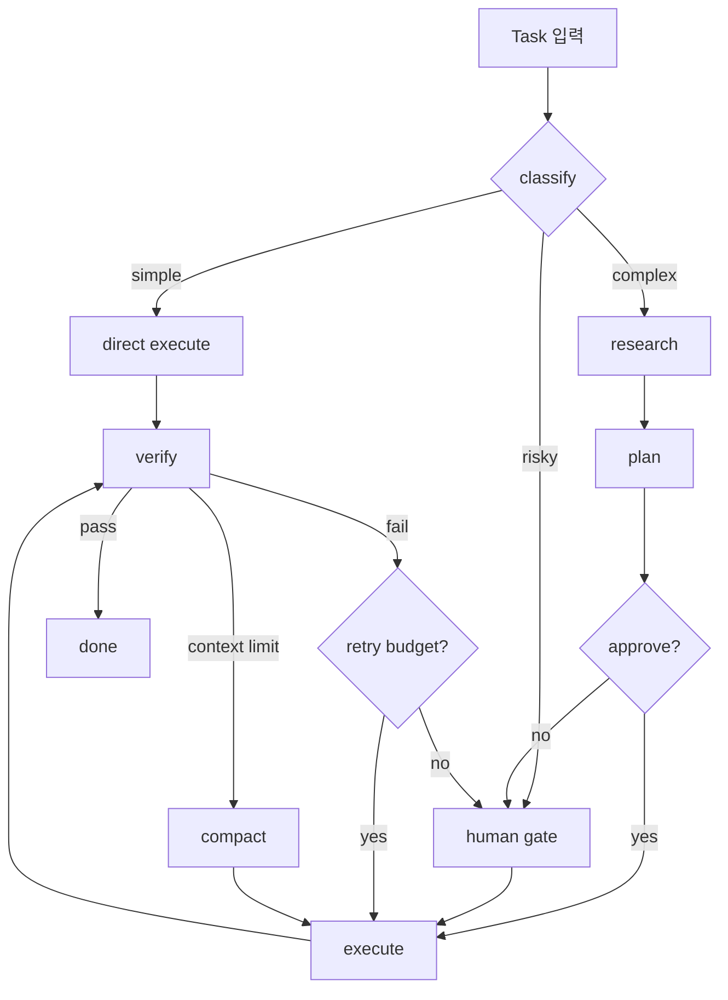

# xcode Agentic Workflow + Graph Engineering 설계 제안

> 참고: Claude Code, Codex CLI, 가재코드(GJC), LazyZ/OmO, pi-coding-agent
> 원칙: 범용 AI IDE 빌더가 아니라, **개발자가 AI에게 끝까지 일하게 만드는 agent-native coding IDE**를 목표로 한다.

---

## 1. 현재 자산 진단 (제로베이스가 아님)

| 개념 | LazyZ 현재 | xcode에서의 격차 |
|---|---|---|
| Loop Engineering | `ulw-plan`, `start-work`, `ulw-loop` | 독립 harness로 일반화 필요 |
| Multi-Agent Orchestration | ZCode `Agent` tool + 10 subagents | handoff 표준화, 상태 기계화 필요 |
| Context Compaction | ZCode 내장 compaction + LazyZ hook | 다층 파이프라인 설계 필요 |
| Graph Engineering | 없음 (Static workflow 위주) | Dynamic workflow engine 필요 |
| Verified Completion | evidence ledger, gate review | 일반화 및 UI 통합 필요 |
| Skill System | 25 skills | marketplace, sandbox, signing 필요 |
| Model Provider | ZCode provider에 종속 | OpenAI/Anthropic/Gemini/local adapter 필요 |

---

## 2. 번역 원칙

- **IDE에 종속되지 않는다**: xcode core engine은 CLI, Tauri, VS Code extension 모두에서 동작.
- **loop가 핵심이다**: 모든 agent는 끝까지 일하게 만드는 loop 안에서 실행.
- **context는 비용이다**: 필요한 기억만, 감당할 수 있는 비용으로 전달.
- **검증은 필수다**: artifact 기반 증거 없이 완료를 주장하지 않는다.
- **확장은 생태계로**: skill marketplace, model provider ecosystem.

---

## 3. Dynamic Workflow 설계

### 3.1 Node 카탈로그

| 노드 | 빌더 UI | 설명 |
|---|---|---|
| `classify` | ✅ | task 난이도/위험도 분류 |
| `research` | ✅ | 코드베이스/외부 탐색 |
| `plan` | ✅ | 실행 계획 생성/리뷰 |
| `execute` | ✅ | checkbox 실행 |
| `verify` | ✅ | acceptance criteria 검증 |
| `human_gate` | ✅ | 사용자 승인 대기 |
| `compact` | ✅ | context compaction 후 재개 |
| `retry` | ✅ | 조걶적 재시도 |

### 3.2 Dynamic Workflow 예시



### 3.3 안전장치

- 각 노드별 timeout.
- 노드별 retry policy.
- `human_gate`는 사용자가 명시적으로 승인/거부.
- workflow graph는 사이클을 허용하지 않음 (DAG 또는 명시 loop 노드로 제한).

---

## 4. Multi-Agent Handoff 표준

```json
{
  "protocol_version": "1.0",
  "task_id": "task_123",
  "from": "PlannerAgent",
  "to": "ExecutorAgent",
  "checkpoint": {
    "status": "done",
    "goal": "...",
    "plan": {"checkboxes": [...]},
    "deliverables": [...],
    "notes": "...",
    "warnings": [...]
  },
  "context_uri": "memory://working/task_123",
  "escalation": false
}
```

---

## 5. 이후 페이즈

| Phase | 내용 | 상태 |
|---|---|---|
| 1 | LoopEngine + TaskLedger + ExecutorAgent | 계획 |
| 2 | PlannerAgent + ReviewerAgent + CompactionEngine | 계획 |
| 3 | Multi-Agent Orchestrator + WorkflowEngine | 계획 |
| 4 | Visual canvas, A/B agent, marketplace | 계획 |

---

*문서 작성: 2026-07-25*
