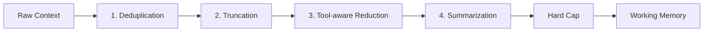
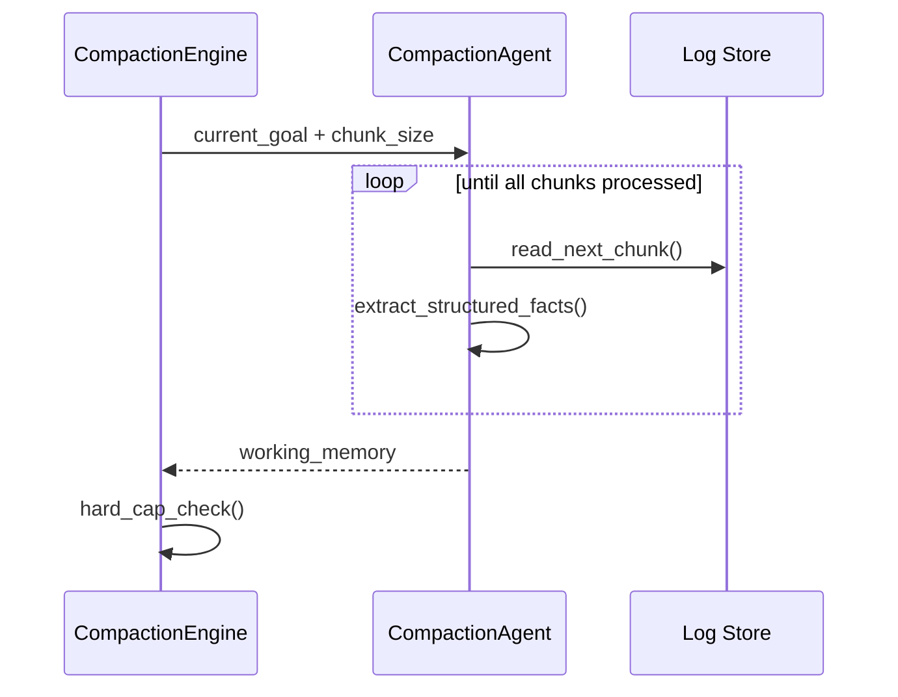

# xcode Context Compaction Architecture 제안

> 원칙: AI에게 더 많은 기억을 주는 게 아니라, 필요한 기억만 감당할 수 있는 비용으로 전달한다.

---

## 1. 문제 정의

에이전트는 매번 이전 context를 함께 읽는다. 대화, 파일 내용, 툴 결과, 실패 기록이 쌓이면 새로운 일을 하는 비용보다 과거를 다시 읽는 비용이 더 커진다. 그래서 context 관리가 하네스의 핵심이다.

---

## 2. 4단계 Compaction Pipeline



### 2.1 Deduplication

- 동일한 툴 결과가 반복되면 최신 것만 남기고 이전 것은 `[ref: id]`로 대체.
- 예: `git status`, `cargo check`, 동일 파일의 반복된 read.

### 2.2 Truncation

- 완료된 오래된 대화/툴 결과를 잘라냄.
- 보존: system message, working memory, 최근 N턴.

### 2.3 Tool-aware Reduction

- 파일 전체 내용 → diff summary.
- 긴 로그 → 마지막 50줄 + 에러 요약.
- 거대한 JSON → schema + changed fields.

### 2.4 Summarization

- 현재 task 목표를 입력으로 받는다.
- 찾는 것: 현재 목표, 이미 내린 결정, 수정한 파일과 상태, 실패한 시도, 다음에 해야 할 일.
- 요약을 덧붙이는 게 아니라 계속 다시 쓴다.

---

## 3. Compaction Agent Loop

전체 로그가 너무 길면 한 번에 요약하지 않는다. Compaction agent에게 chunk 단위로 읽는 도구를 준다.



---

## 4. Working Memory Schema

```json
{
  "goal": "현재 목표",
  "decisions": [...],
  "modified_files": [...],
  "failed_attempts": [...],
  "next_steps": [...],
  "open_questions": [...],
  "references": ["log_chunk_12", "tool_result_45"]
}
```

---

## 5. Hard Cap

| 단계 | Token 비율 | 조치 |
|---|---|---|
| 경고 | 80% | dedup/truncation 강화 |
| 감축 | 95% | summarization + tool-aware reduction 강제 |
| 하드캡 | 100% | 가장 큰 결과부터 자르기, working memory만 보존 |

---

## 6. 안전장치

- compaction 전후 working memory checksum 비교.
- 사용자가 compaction 결과를 검토할 수 있는 UI.
- 중요한 결정은 절대 자동 삭제하지 않음 (명시 보관).

---

*문서 작성: 2026-07-25*
