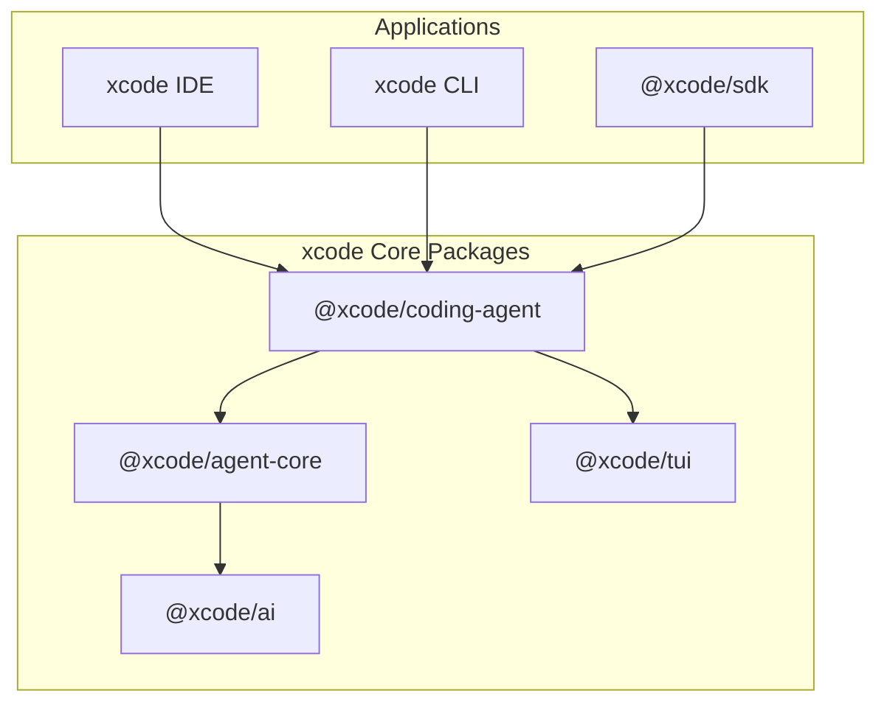

# xcode에 pi-coding-agent 기반 모델 통합 제안

- 문서 버전: v1.0-pi
- 작성일: 2026-07-25
- 기반 모델: **pi-coding-agent** — unified LLM API, agent loop, TUI, coding agent CLI

> 참고: [earendil-works/pi](https://github.com/earendil-works/pi)
> 원칙: **pi를 그대로 복제하지 않고**, pi의 소스코드, 알고리즘, 아키텍처, 서비스 흐름을 xcode의 agent-native IDE에 맞게 번역한다.

---

## 1. 기반 모델 선정 이유

pi는 다음에서 입증된 구조를 가진다.

| 영역 | pi의 실제 구현 | xcode에 주는 시사점 |
|---|---|---|
| 패키지 구조 | `@earendil-works/pi-ai`, `pi-agent-core`, `pi-coding-agent`, `pi-tui` | xcode도 동일 4-package 구조로 분리 |
| Agent Loop | `AgentMessage[] → transformContext() → convertToLlm() → Message[] → LLM` | 표준화된 메시지 처리 파이프라인 |
| Session | JSONL append-only tree (`id`/`parentId`) | branching/replay/compaction의 기반 |
| Compaction | `reserveTokens`/`keepRecentTokens` 기반 auto/manual + branch summarization | 긴 세션에서도 context 관리 가능 |
| Extension | jiti 기반 TypeScript factory + 30+ lifecycle events | 거의 무한한 확장성 |
| Skill | Agent Skills standard + progressive disclosure | marketplace 없이도 생태계 형성 |
| Prompt Template | frontmatter + positional args | reusable prompt 시스템 |
| Package | npm/git/local + pinned refs + `--ignore-scripts` | 안전한 distribution |
| Provider | 30+ built-in + custom via `models.json`/extension | 다양한 LLM 연동 |
| Supply-chain | pinned deps, shrinkwrap, audit signatures | 신뢰할 수 있는 빌드/배포 |

---

## 2. xcode Core Packages (pi 번역)



### 2.1 @xcode/ai ← @earendil-works/pi-ai

- `createModels()`: ModelRegistry 생성
- `models.setProvider()`: provider 등록
- `models.getModel(provider, id)`: model 조회
- `models.streamSimple()`: unified streaming function
- Auth resolution: CLI flag → `auth.json` → env var → `models.json`
- `models-store.json`: offline catalog cache

### 2.2 @xcode/agent-core ← @earendil-works/pi-agent-core

- `Agent` class: stateful agent
- `agentLoop()` / `agentLoopContinue()`: low-level API
- Event streaming: `agent_start`, `turn_start`, `message_update`, `tool_execution_end`, `turn_end`, `agent_end`
- Tool registry + parallel/sequential execution
- Steering/Follow-up queues
- `beforeToolCall` / `afterToolCall` hooks

### 2.3 @xcode/coding-agent ← @earendil-works/pi-coding-agent

- `SessionManager`: JSONL tree + branching
- `CompactionEngine`: pi compaction algorithm
- `ExtensionRuntime`: jiti + ExtensionAPI
- `SkillRegistry`: Agent Skills standard
- `PromptTemplateRegistry`: frontmatter templates
- `PackageManager`: npm/git/local
- `ProjectTrust`: `.xcode/` 승인
- `ContextFileLoader`: `AGENTS.md`/`CLAUDE.md`
- Built-in tools: read, write, edit, bash, grep, find, ls

### 2.4 @xcode/tui ← @earendil-works/pi-tui

- Differential terminal rendering
- Editor component
- Message/tool result rendering
- Footer with token/cost/model info

---

## 3. Agent Loop 통합

xcode의 모든 실행은 다음 흐름을 따른다.

```
User Input
  → Extension command check
  → input event
  → skill/template expansion
  → before_agent_start
  → agent_start
  → turn_start
  → context building (SessionManager)
  → convertToLlm()
  → LLM streaming
  → message_update / message_end
  → tool_execution_start
  → tool_call (extension can block)
  → tool execution
  → tool_result (extension can modify)
  → tool_execution_end
  → turn_end
  → (more turns if tool calls)
  → agent_end / agent_settled
```

### 3.1 xcode IDE 연동

- IDE는 `@xcode/coding-agent`의 RPC mode로 연결
- 모든 event를 IDE UI에 rendering
- Monaco editor는 user input 수집
- Steering message: IDE에서 agent 실행 중에도 입력 가능

### 3.2 xcode CLI 연동

- Print/JSON/RPC mode는 `@xcode/coding-agent`에서 직접 지원
- TUI mode는 `@xcode/tui`로 렌더링

---

## 4. Session Tree 통합

### 4.1 파일 경로

```
~/.xcode/agent/sessions/--<cwd>--/<timestamp>_<uuid>.jsonl
```

### 4.2 Entry Types 그대로 채택

pi의 모든 entry type을 xcode에서 동일하게 사용:
- `session`, `message`, `model_change`, `thinking_level_change`
- `compaction`, `branch_summary`
- `custom`, `custom_message`, `label`, `session_info`

### 4.3 IDE에서의 Branching UX

- 세션 히스토리 패널에 tree visualization
- 임의 message에서 "여기서 분기" 선택 → `/tree` 동작
- Fork/Clone 버튼 → 새 세션 파일 생성

---

## 5. Compaction Algorithm 통합

pi의 compaction algorithm을 그대로 구현.

### 5.1 Settings

```json
{
  "compaction": {
    "enabled": true,
    "reserveTokens": 16384,
    "keepRecentTokens": 20000
  }
}
```

### 5.2 Summary Format

pi의 structured summary format을 그대로 사용:
- Goal
- Constraints & Preferences
- Progress (Done/In Progress/Blocked)
- Key Decisions
- Next Steps
- Critical Context
- readFiles / modifiedFiles

### 5.3 Extension Hooks

- `session_before_compact`: custom summary 또는 cancel
- `session_compact`: post-compaction 처리
- `session_before_tree`: branch navigation custom summary 또는 cancel

---

## 6. Extension System 통합

### 6.1 ExtensionAPI

pi의 ExtensionAPI를 xcode에서 동일하게 제공.

| API | xcode 제공 |
|---|---|
| `pi.on(event, handler)` | ✅ |
| `pi.registerTool()` | ✅ |
| `pi.registerCommand()` | ✅ |
| `pi.registerShortcut()` | ✅ |
| `pi.registerProvider()` | ✅ |
| `pi.appendEntry()` | ✅ |
| `ctx.ui.notify/confirm/select/input/custom()` | ✅ |
| `ctx.sessionManager` | ✅ |
| `ctx.modelRegistry` | ✅ |
| `ctx.signal` | ✅ |
| `ctx.compact()` | ✅ |

### 6.2 Extension Loading

- jiti로 TypeScript 직접 로드 (컴파일 불필요)
- Global: `~/.xcode/agent/extensions/`
- Project-local: `.xcode/extensions/` (trust 필요)
- Package: `extensions/` directory 또는 `xcode.extensions`

### 6.3 IDE-specific Extensions

- xcode IDE는 extension이 custom UI component를 등록할 수 있도록 확장
- `ctx.ui.custom()`을 활용한 TUI component는 IDE에서는 별도 panel로 매핑

---

## 7. Skill & Prompt Template 통합

### 7.1 Skill

- Agent Skills standard 그대로 채택
- `SKILL.md` frontmatter: name, description, license, compatibility, metadata, allowed-tools
- Progressive disclosure: descriptions in system prompt, full SKILL.md on-demand
- `/skill:name` command

### 7.2 Prompt Template

- Markdown + frontmatter
- Positional args: `$1`, `$2`, `$@`, `${1:-default}`, `${@:N:L}`
- Filename이 `/command`가 됨

---

## 8. Package System 통합

### 8.1 Commands

```bash
xcode install npm:@foo/xcode-tools@1.0.0
xcode install git:github.com/user/repo@v1
xcode install ./local-path
xcode remove npm:@foo/xcode-tools
xcode update --all
xcode list
xcode config
```

### 8.2 Manifest

```json
{
  "name": "my-xcode-package",
  "keywords": ["xcode-package"],
  "xcode": {
    "extensions": ["./extensions"],
    "skills": ["./skills"],
    "prompts": ["./prompts"],
    "themes": ["./themes"]
  }
}
```

### 8.3 Security

- `--ignore-scripts` by default
- Pinned npm versions skipped by update
- Git refs are pinned tags/commits
- `npm-shrinkwrap.json` for transitive deps

---

## 9. Multi-Provider LLM 통합

### 9.1 Built-in Providers

pi의 provider catalog를 기반으로 xcode도 동일 provider 지원:
- Anthropic, OpenAI, Google, Azure OpenAI, DeepSeek, Groq, etc.
- Local: llama.cpp, Ollama

### 9.2 Auth

```json
// ~/.xcode/agent/auth.json
{
  "anthropic": { "type": "api_key", "key": "sk-ant-..." },
  "openai": { "type": "api_key", "key": "sk-..." }
}
```

파일 권한: `0600`

### 9.3 Custom Provider

- `~/.xcode/agent/models.json`
- Extension의 `pi.registerProvider()`

---

## 10. Development Culture (pi AGENTS.md / CONTRIBUTING.md 반영)

### 10.1 Core Philosophy

> **xcode core is minimal.** core에 속하지 않는 기능은 extension으로 만든다.
>
> **You must understand your code.** AI로 코드를 짜는 것은 괜찮지만, 이해하지 못한 채 제출하는 것은 안 된다.

### 10.2 Coding Rules

- `no any` unless absolutely necessary
- No inline imports (`await import()`, dynamic type imports)
- Use only erasable TypeScript syntax (Node strip-only mode)
- Never hardcode key checks; use configurable keybinding defaults
- Never modify `models.generated.ts` directly; regenerate via script
- After code changes: `npm run check` (full output, no tail)
- For tests: `./test.sh` from repo root; never run full vitest suite directly (includes LLM-dependent e2e)

### 10.3 Git & Release

- Stage explicit paths only; never `git add -A`
- Never `git reset --hard`, `git checkout .`, `git clean -fd`, `git stash`, force push
- Commit format: `{feat,fix,docs}[(ai,tui,agent,coding-agent)]: <message>`
- Lockstep versioning: all packages share one version
- Release smoke test via `npm run release:local`
- npm trusted publishing through GitHub Actions OIDC

---

## 11. MVP Scope (pi 기반)

### Phase 1 In Scope

| 컴포넌트 | pi 대응 | 우선순위 |
|---|---|---|
| `@xcode/ai` core | `pi-ai` | P0 |
| `@xcode/agent-core` Agent loop | `pi-agent-core` | P0 |
| `@xcode/coding-agent` SessionManager | `pi-coding-agent` | P0 |
| `@xcode/coding-agent` CompactionEngine | `pi-coding-agent` compaction | P0 |
| Built-in tools | pi built-in tools | P0 |
| IDE skeleton (Tauri + RPC mode) | pi interactive/TUI 번역 | P0 |
| Project Trust | pi project_trust | P0 |
| Context File Loader | pi context files | P0 |
| Print/JSON mode | pi print/json mode | P1 |

### Phase 1.5 In Scope

| 컴포넌트 | pi 대응 |
|---|---|
| Extension runtime | pi extensions |
| Skill system | pi skills |
| Prompt templates | pi prompts |
| Message queue (steering/follow-up) | pi steering/follow-up |
| TUI mode | pi-tui |
| Containerization (Plain Docker, Gondolin) | pi containerization docs |
| Release smoke test & lockstep versioning | pi AGENTS.md releasing |

### Phase 2 In Scope

| 컴포넌트 | pi 대응 |
|---|---|
| Pi packages | pi packages |
| Code Intelligence extension | custom extension |
| Admin/Ops extension | custom extension |

---

## 12. 리스크 및 완화

| 리스크 | 완화 |
|---|---|
| pi 의존성이 너무 강함 | xcode는 pi의 "아이디어/알고리즘"을 참고하되, 코드는 직접 작성 |
| Extension full system access | Project Trust + optional sandbox/container |
| Package supply-chain 공격 | `--ignore-scripts`, pinned refs, audit, shrinkwrap, pre-commit lockfile guard |
| LLM provider 장애 | multi-provider fallback |
| JSONL session corruption | checksum, backup, migration path |
| Host-level isolation | Gondolin/Docker/OpenShell containerization patterns |

---

## 13. 문서 반영 현황

| 문서 | 반영 내용 |
|---|---|
| `README.md` | 문서 중앙 저장소 개요, 4-package 구조, pi 기반 모델 요약 |
| `00-기획/서비스기획서.md` | pi 기반 비전, 패키지 구조, 서비스 흐름 |
| `00-기획/비즈니스정책서.md` | extension/package security, Project Trust, 플랜 정책 |
| `01-요구사항분석/요구사항명세서-SRS.md` | entry types, events, tools, auth |
| `02-시스템설계/시스템아키텍처설계서-SAD.md` | 4-package 구조, component map |
| `02-시스템설계/API설계서.md` | session tree API, event 기반 API, provider/package API |
| `03-상세설계/상세설계서.md` | agent loop, session tree, compaction algorithm, extension API, containerization |
| `04-구현/구현가이드.md` | monorepo 구조, jiti extension, supply-chain, AGENTS.md/CONTRIBUTING.md 개발 문화, Git 규칙, release 절차 |
| `05-테스트/테스트계획서.md` | pi event/session/compaction/extension/package tests |
| `06-배포/배포계획서.md` | 4-package monorepo 배포, CI 게이트, supply-chain |
| `07-유지보수/유지보수계획서.md` | session JSONL integrity, package audit, compaction 품질 점검 |
| `08-검토/Phase1-MVP-범위확정서.md` | pi 기반 MVP |
| `08-검토/우선순위-로드맵.md` | pi 기반 phase |
| `09-운영런북/장애대응-런북.md` | package/extension/JSONL/LLM 장애 대응 |

---

*문서 작성: 2026-07-25 · pi-coding-agent 소스/알고리즘/아키텍처 기반*
